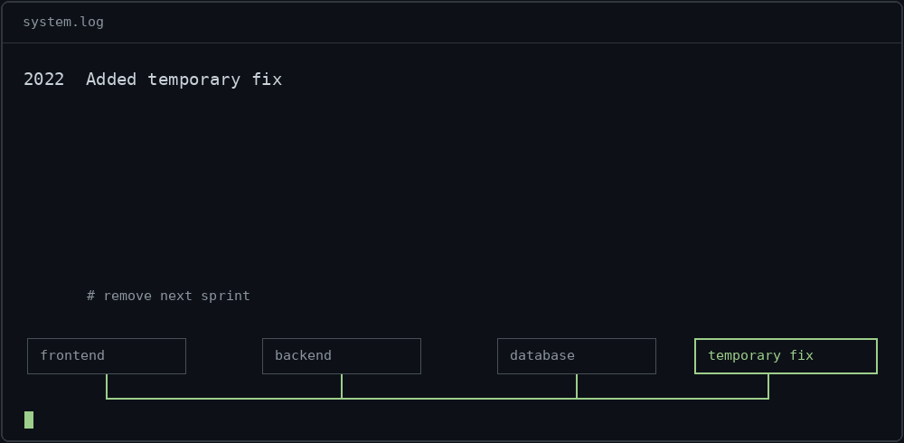

Temporary solutions have excellent survival instincts.

[](https://github.com/lukenge-lukard/lukenge-lukard/blob/main/index.html)

[View source](temporary_fix.py) · [Still frame](assets/temporary-fix.png)

<details>
<summary>Run it</summary>

```sh
git clone https://github.com/lukenge-lukard/lukenge-lukard.git
cd lukenge-lukard
python3 temporary_fix.py
```

Or open `index.html` in your browser. Try removing the temporary fix.

</details>
